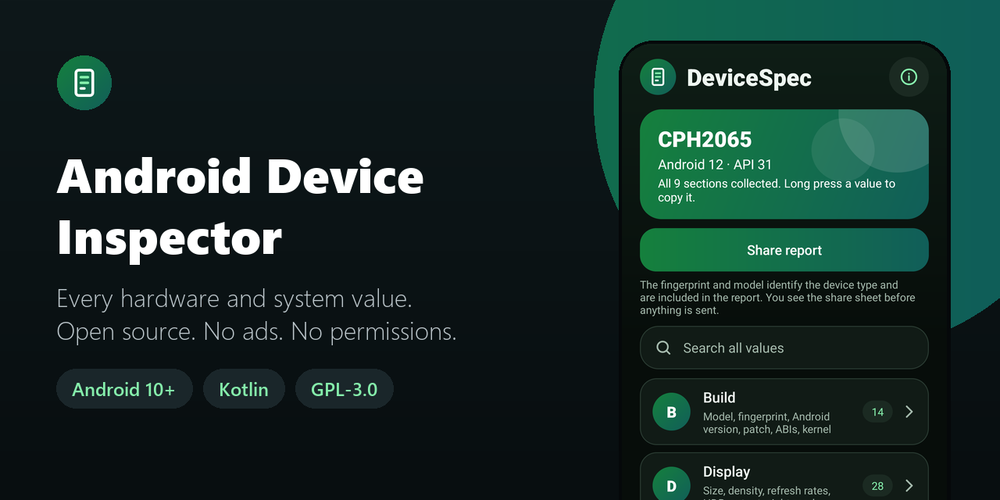
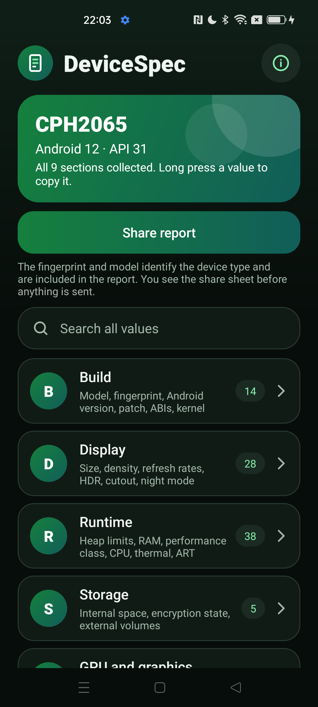
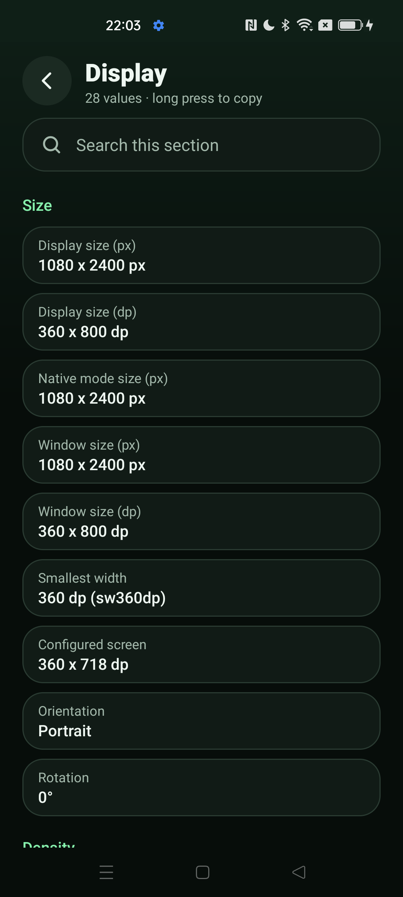
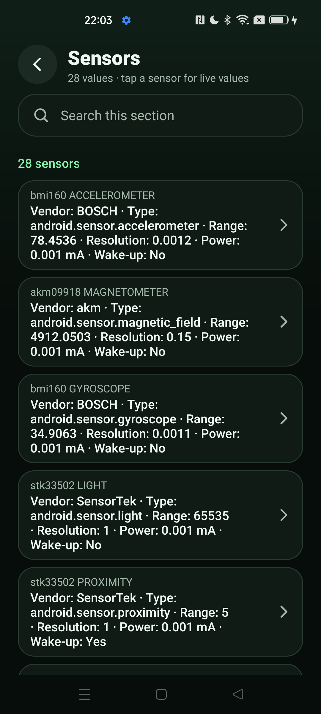
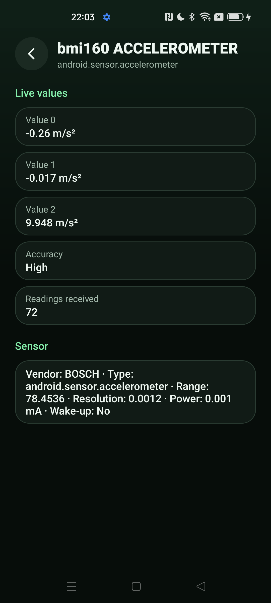

<div align="center">



# Android Device Inspector

**The facts about a test device that matter when debugging, in one place, with a report to paste into a bug. Works offline. Open source, no ads, no analytics.**

[](LICENSE)
[](#requirements)
[](https://kotlinlang.org)
[](app/build.gradle.kts)
[](app/src/main/AndroidManifest.xml)
[](https://github.com/Nekuzaky/android-device-inspector/stargazers)

</div>

Android Device Inspector ships an app called **DeviceSpec**. It shows what a test device really is, from the build fingerprint to the codecs and sensors it has, and builds a plain-text report for a bug tracker.

DeviceSpec declares no permissions at all, so it has no Internet access and nothing leaves the device unless you share a report yourself.

## Screenshots

<p align="center">
  
  
  
  
</p>

## Features

| Section | What it shows |
| --- | --- |
| **Build** | Model, manufacturer, brand, product, device, fingerprint, Android version, API level, security patch, build type and tags, bootloader, supported ABIs, kernel from `os.version` |
| **Display** | Size in px and dp, window size, density and dpi bucket, refresh rates and modes, HDR, wide colour, cutout, smallest width, font scale, night mode. Updates live on rotation |
| **Runtime** | `maxMemory`, `memoryClass`, `largeMemoryClass`, RAM total and available, low RAM flag, swap, media performance class, CPU core count and frequencies where readable, thermal status, ART and JVM properties |
| **Storage** | Internal total and free, encryption state from `DevicePolicyManager`, external volumes |
| **GPU and graphics** | OpenGL ES version, renderer, vendor and extensions from an offscreen EGL context, Vulkan feature flags, graphics hardware features |
| **Media** | Every `MediaCodecList` codec: encoder or decoder, hardware or software, types, max resolutions |
| **Sensors** | Vendor, type, range, resolution and power, plus a live value view for the selected sensor |
| **System features** | Everything from `getSystemAvailableFeatures` |
| **Developer** | Developer options, ADB, stay awake and animator scales, read from public `Settings.Global` values |

- **Search:** across all values, labels and sections, and within a section
- **Copy:** long press any value to copy it
- **Report:** share a plain-text report through the Android share sheet
- No ads, no analytics, no account and no third-party libraries

## The report

The report is plain text with one value per line, so it pastes cleanly into a bug:

```text
DeviceSpec report
Generated: <time in UTC>
App version: 1.0.0
Note: the fingerprint and model identify the device type and are included in this report.
Not read: IMEI, serial number, Android ID, MAC address, accounts, phone numbers, advertising ID.

== Build ==
-- Device type --
Model: <model>
Fingerprint: <fingerprint>
...
```

**The fingerprint and model identify the device type and are included in the report.** The app says the same next to the share button. They name a kind of device and a software build, not one specific unit, but read the report before you post it somewhere public. You see the share sheet before anything is sent.

## How it works

1. The app starts one background task per section. Nothing is collected on the main thread.
2. Every value is read inside its own catch of `Throwable`. OEM builds differ, so a value that a device refuses to give is shown as **Unavailable** and the rest of the section still loads.
3. A section that has not answered after 15 seconds is shown as **Unavailable**, so one stuck vendor driver cannot hold back the report. If the answer arrives later, it replaces that row.
4. The live sensor view registers its listener only while the screen is visible, and unregisters it when the screen is not.

OS text is treated as untrusted and is bounded:

| Limit | Value |
| --- | --- |
| Length of one value | 2,000 characters |
| Entries in one section | 2,000 |
| Length of the report | 64,000 characters |
| Bytes read from a `/proc` or sysfs file | 256 KiB |

Line breaks, control characters and bidi formatting characters are removed from OS text, so a value cannot add fake lines to a report. Anything cut is marked as cut.

## Privacy

- No permissions, so no Internet access, and no runtime permission prompts.
- No analytics and no logging.
- Nothing is stored. Values are read again each time the app runs.
- `allowBackup` is off, and the data extraction rules exclude everything.
- Only the launcher activity is exported, and it reads nothing from its intent.

**Not read:** IMEI, serial number, Android ID, MAC address, accounts, phone numbers, advertising ID and storage volume UUIDs. The `Serial` line that some kernels print in `/proc/cpuinfo` is skipped by the parser.

**Networking is left out on purpose.** The only local facts available would need `ACCESS_NETWORK_STATE`, and they would not be worth giving up an app with no permissions.

## Requirements

- Android 10 (API 29) or later
- JDK 21 and Android SDK 35 to build from source

Gradle 8.11 does not support the Java 25 runtime bundled with recent Android Studio versions, so use a separate JDK 21.

## Download

Download the signed APK from the [latest release](https://github.com/Nekuzaky/android-device-inspector/releases/latest) and open it on your phone. Android may ask you to allow installs from the app you opened it with.

The release notes list the SHA-256 checksum of the APK and of its signing certificate.

## Build from source

A build signed with your own key cannot install over the release APK, so uninstall the app first.

```bash
git clone https://github.com/Nekuzaky/android-device-inspector.git
```

```bash
cd android-device-inspector
```

Create a `local.properties` file that points to your Android SDK:

```properties
sdk.dir=/path/to/Android/Sdk
```

Build a debug APK with JDK 21:

```bash
JAVA_HOME=/path/to/jdk-21 ./gradlew assembleDebug
```

To sign a release build, create a signing key, then add a `keystore.properties` file at the project root. It is ignored by Git, so never commit it or your key. Without this file the build still works, and `assembleRelease` gives an unsigned APK:

```properties
storeFile=/path/to/your-key.jks
storePassword=your-password
keyAlias=release
keyPassword=your-password
```

```bash
JAVA_HOME=/path/to/jdk-21 ./gradlew assembleRelease
```

Install it on a phone with USB debugging enabled:

```bash
adb install -r --user 0 app/build/outputs/apk/debug/app-debug.apk
```

Run the unit tests:

```bash
JAVA_HOME=/path/to/jdk-21 ./gradlew testDebugUnitTest
```

## Limitations

- **Unavailable values.** Some devices block `/sys/devices/system/cpu` files and others, so CPU frequencies can show as **Unavailable**. That is expected.
- **Native driver crashes.** A catch in Kotlin cannot stop a crash inside a vendor GPU driver. The offscreen EGL context is the only place DeviceSpec runs vendor code directly.
- **Refresh on return.** Display, Runtime, Storage and Developer are read again when you return to a screen. Runtime values do not tick while you watch them. The other sections are read once per app run.
- **Volume size.** On Android 10, the size of a secondary volume cannot be read through a public API, so it shows as **Unavailable**.
- **Sensors behind a permission.** Sensors such as heart rate or step counter may not start, because DeviceSpec requests no permissions. The live view says so.
- **One-shot sensors.** They have no stream, so the live view cannot show them.
- **Search and report in English.** All text is in English only.

## Test status

On the development machine:

| Check | Result |
| --- | --- |
| `testDebugUnitTest` | 73 tests, 0 failures |
| `assembleDebug` | Build successful |
| `assembleRelease` without `keystore.properties` | Build successful, unsigned APK |
| `lintDebug` | No errors |

The unit tests cover size and frequency formatting, dp calculations, density buckets, report generation, search filtering, value guards, `/proc` and sysfs parsing with malformed input, and checks on the manifest and sources for permissions, exported activities, identifiers, logging and comments. They do not run any Android API.

With a debug build on one phone: Oppo Reno4 Z 5G, Android 12, ColorOS.

| Check | Result |
| --- | --- |
| Model, Android version, security patch, fingerprint, ABIs and kernel, compared with `getprop` and `uname` | Same |
| Display size in portrait and landscape, compared with `wm size` | Same |
| All 9 sections collected | Works |
| Live sensor view | Values update, and the sensor is released on leaving the screen |
| Search across all values | Works |
| Share report | The share sheet opens |
| Direct launch of the internal screens from ADB | Refused |
| Signed release build: install, home screen, Build section | Works, no crash |

Not tested: the values in the Runtime, Storage, GPU, Media and Developer sections against another source, a signed release build, other brands, Android 10, 11, 13 and later, tablets, and work profiles. If something breaks on your device, please open an issue.

## Related

- [Android Tracker Detector](https://github.com/Nekuzaky/android-tracker-detector): find the ad and tracking code inside your apps.
- [Android App Firewall](https://github.com/Nekuzaky/android-app-firewall): cut Internet access per app.
- [Android Permission Manager](https://github.com/Nekuzaky/android-permission-manager): see what every app can access.
- [Android App Duplicator](https://github.com/Nekuzaky/android-app-duplicator): run a second account of an app in a work profile.

## License

Distributed under the [GNU General Public License v3.0](LICENSE).
